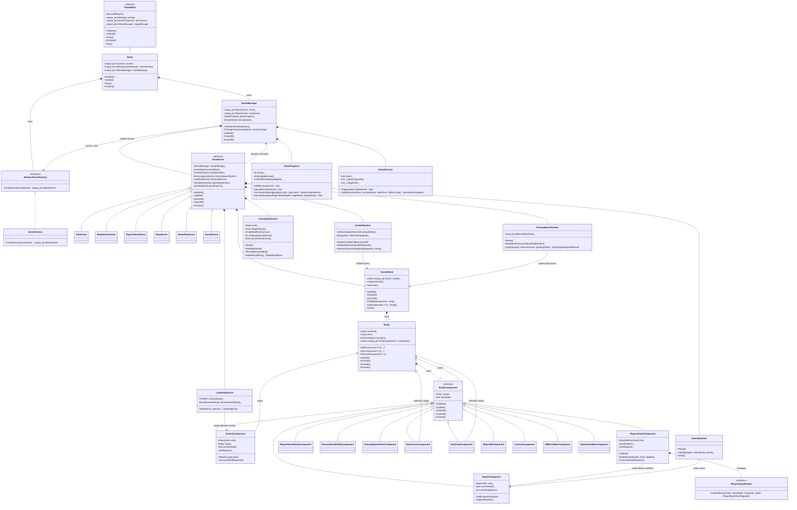
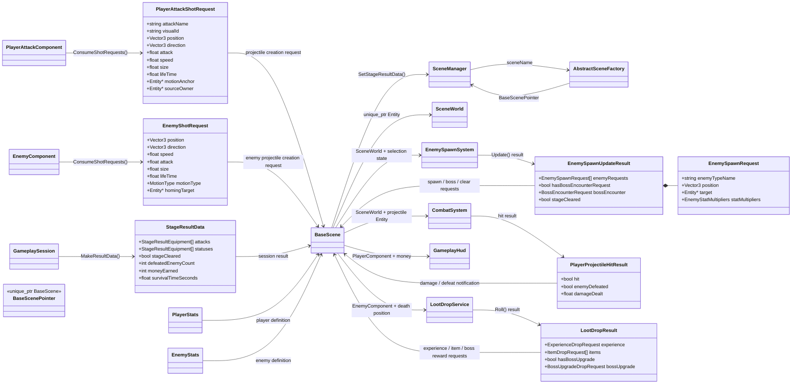

# CG2_DirectX 主要クラス設計 UML

この図は、ゲームの実行・シーン管理・Entity/Component・戦闘処理という、実装の中心になるクラスだけを示す。
DirectX の低レベル描画クラス、UI 用 Sprite、エディタ専用クラス、値オブジェクト、外部ライブラリは省略している。

## クラス間で受け渡すデータ

`BaseScene` は各ComponentやSystemを直接実装するのではなく、要求・結果を値として受け取り、Entity生成や進行状態への反映を調整する。

### 受け渡し内容一覧

| 送り元 | 受け取り先 | 渡すもの | 目的 |
|---|---|---|---|
| `SceneManager` | `AbstractSceneFactory` | シーン名 `string` | 指定された種類のシーンを生成する |
| `AbstractSceneFactory` | `SceneManager` | `unique_ptr<BaseScene>` | 生成したシーンの所有権を渡す |
| `PlayerAttackComponent` | `BaseScene` | `vector<PlayerAttackShotRequest>` | 攻撃の位置、方向、威力、速度、寿命、軌道を渡し、弾Entityを生成する |
| `EnemyComponent` | `BaseScene` | `vector<EnemyShotRequest>` | 敵弾の位置、方向、威力、速度、寿命、軌道を渡す |
| `BaseScene` | `EnemySpawnSystem` | `SceneWorld&`、選択画面状態、保留報酬状態 | スポーン地点とボスの状態を調べる |
| `EnemySpawnSystem` | `BaseScene` | `EnemySpawnUpdateResult` | 通常敵生成要求、ボス戦開始要求、ステージクリアを通知する |
| `BaseScene` | `CombatSystem` | `SceneWorld&`、弾Entity、敵Entity | 衝突候補の検索と精密判定を依頼する |
| `CombatSystem` | `BaseScene` | `PlayerProjectileHitResult` | 命中有無、撃破有無、実ダメージを返す |
| `BaseScene` | `LootDropService` | 撃破された `EnemyComponent` と座標 | 敵設定に基づくドロップ抽選を依頼する |
| `LootDropService` | `BaseScene` | `LootDropResult` | 経験値、アイテム、ボス報酬の生成要求を返す |
| `GameplaySession` | `BaseScene` | `StageResultData` | クリア状態、撃破数、獲得金、生存時間を確定する |
| `BaseScene` | `SceneManager` | 装備情報を加えた `StageResultData` | シーン切り替え後も戦績を保持し、リザルト画面へ引き継ぐ |
| `BaseScene` | `GameplayHud` | `PlayerComponent*`、獲得金、表示可否 | HP、経験値、装備、獲得金を表示する |
| `BaseScene` | `SceneWorld` | `unique_ptr<Entity>` | 生成したEntityの所有権をSceneWorldへ移す |
| Repository群 | `BaseScene` / Assembler群 | `PlayerStats`、`EnemyStats`、攻撃定義 | JSONの保存データを実行時Componentへ反映する |

## 設計の中心

1. `FlameWork` がエンジンのメインループを持ち、`Game` がゲーム固有の初期化・更新・描画を実装する。
2. `SceneManager` が現在シーンと次シーンを所有し、生成は `AbstractSceneFactory` に委譲する。
3. `BaseScene` がシーン共通の処理を提供し、各画面はこれを継承して固有処理だけを追加する。
4. `SceneWorld` がすべての `Entity` の寿命と検索索引を管理する。
5. `Entity` は `EntityComponent` を合成し、プレイヤー、敵、攻撃、描画、当たり判定などの機能を組み合わせる。
6. 戦闘判定、敵生成、ドロップ抽選、プレイ戦績、HUD は専用クラスへ分離し、`BaseScene` が処理順を調整する。

## 矢印の意味

- `<|--`：継承
- `<|..`：インターフェース実装
- `*--`：合成。接続元が接続先の寿命を所有する
- `-->`：利用・参照。接続先の所有権は持たない

このプロジェクトのクラス設計を説明する場合は、最初に
`Game → SceneManager → BaseScene → SceneWorld → Entity → EntityComponent`
の流れを示し、その後に `CombatSystem` などの役割分担を説明すると全体像が伝わりやすい。
